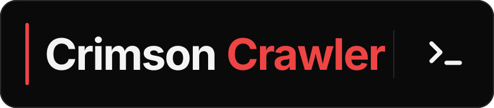

# Crimson Crawler CLI

<p align="center">
  <a href="https://crimsoncrawler.com">
    
  </a>
</p>
<p align="center">
  <a href="https://crimsoncrawler.com">
    
  </a>
</p>
<p align="center"><strong>Threat intelligence from your shell, ready for analysts and pipelines.</strong></p>
<p align="center">
  <a href="https://crimsoncrawler.com/docs/clients/cli/">Documentation</a> ·
  <a href="https://pypi.org/project/crimson-crawler-cli/">PyPI</a> ·
  <a href="https://github.com/crimson-crawler/ccc">GitHub</a> ·
  <a href="https://crimsoncrawler.com/dashboard">Get an API key</a>
</p>
<p align="center">
  <a href="https://pypi.org/project/crimson-crawler-cli/"></a>
  
  
  <a href="LICENSE"></a>
</p>

Move from a CVE, package, IOC, or scan file to analyst-ready output without writing an integration. `ccc` renders Rich tables for humans, emits JSON for pipelines, collects CycloneDX inventories offline, and turns 11 scan formats into ranked briefings.

## Install

```bash
uv pip install crimson-crawler-cli
# or
pipx install crimson-crawler-cli
```

Python 3.11+.

Published on [PyPI](https://pypi.org/project/crimson-crawler-cli/).

**Working from a source checkout:** source development depends on the co-released
[`crimson-crawler-client` Python SDK](https://github.com/crimson-crawler/python-sdk) at tag `v4.1.0`.
That repository must be publicly available before `uv sync --extra dev` can resolve the pinned SDK source.
Until the SDK release is available, install the published CLI from PyPI instead of treating a source checkout
as independently buildable. Once both repositories are released, contributors can run:

```bash
uv sync --extra dev
uv run pytest
```

`tests/conftest.py` skips the suite with an actionable message if the SDK's generated tree is missing from the environment.

## Authentication

Two sources, checked in this order:

1. **Environment variable** — recommended for CI and one-off use.

   ```bash
   export CRIMSON_CRAWLER_API_KEY=your-api-key
   ccc whoami
   ```

2. **Config file** at `~/.crimson-crawler/config.toml` — recommended for daily use.

   ```toml
   api_key = "your-api-key"
   ```

   On POSIX systems, the file must be owned by your user and inaccessible to group and other users:

   ```bash
   chmod 600 ~/.crimson-crawler/config.toml
   ```

The env var wins when both are set. Generate a key at [crimsoncrawler.com/dashboard](https://crimsoncrawler.com/dashboard).

The CLI re-uses the SDK's env var name on purpose — the same key works for `ccc` and for `CrawlerClient` in the [Python SDK](https://crimsoncrawler.com/docs/clients/python-client/) / [TypeScript SDK](https://crimsoncrawler.com/docs/clients/typescript-client/).

`ccc whoami` reports which source the CLI picked up and a masked tail of the key. No network call. Use it to confirm your shell is reading the right key before running real commands.


```text
$ ccc whoami
                       Crimson Crawler — auth
┌─────────────────┬───────────────────────────────────────────────┐
│ Source          │ environment variable (CRIMSON_CRAWLER_API_KEY)│
│ API key         │ ••••••••••••••••••••••••••••5a3f              │
│ Config file     │ not present                                   │
└─────────────────┴───────────────────────────────────────────────┘
```

## Custom or local endpoint

The CLI uses the hosted API at `https://crimsoncrawler.com` by default. Point
the official `ccc` package at a local or self-hosted deployment through the
same SDK environment variables:

```bash
export CRIMSON_CRAWLER_BASE_URL=http://localhost:8000
ccc enrich cve CVE-2024-3400
```

Every API command sends its `apikey` header to the selected origin. Use a
local or development key for a custom endpoint. A loopback origin may be
plaintext; any other host must be `https://`. Keep TLS verification enabled
and trust the deployment's CA when possible.

## Quick start

```bash
ccc whoami                                            # confirm which key the CLI picked up (no network call)
ccc enrich cve CVE-2024-3400                          # full CVE → CWE → CAPEC → ATT&CK chain as a Rich table
ccc enrich cve CVE-2024-3400 --json | jq '.cve.cvss_score'   # machine-readable JSON for piping
```

## Commands

`ccc` covers **every one of the 33 `/v1` operations** with a typed command — 17 under `ccc enrich`, 8 under `ccc search`, 4 under `ccc assess`, and the two async enrichment engines — plus the `ccc ingest` scan-to-briefing workflow, the three Platform groups, and two local commands that never touch the network. Each API command calls the matching SDK convenience method, then renders a Rich table on stdout — or, with `--json`, emits the SDK's full response payload as a single JSON blob suitable for `jq`.

| Group | Commands |
|---|---|
| **Enrichment** | `enrich cve` · `enrich product` · `enrich package` · `enrich ioc` · `enrich cwe` · `enrich technique` · `enrich capec` · `enrich group` · `enrich software` · `enrich campaign` · `enrich atlas` · `enrich disarm` · `enrich defend` · `enrich location` · `enrich sector` · `enrich poc-source` · `enrich batch` |
| **Search** | `search cve` · `search cti` · `search kev` · `search misp` · `search knowledgebase` · `search vendor` · `search poc` · `search d3fend` · `search techniques` |
| **Assessment** | `assess technique-coverage` · `assess vulnerability-exposure` · `assess group-exposure` · `assess ioc-portfolio` |
| **Async engines** | `artifact-enrich` (+ `artifact-enrich status`) · `inventory-enrich` (+ `inventory-enrich status`) |
| **Workflows** | `ingest <format> <file>` (scan → ranked briefing) |
| **Platform** (usage-exempt) | `artifact-manager …` · `inventory-manager …` · `reports …` |
| **Local only** | `whoami` · `crawl project` / `crawl endpoint` |

The 15 full-walk `ccc enrich <type>` commands ride the SDK's include presets and take no `--include`; `ccc search cve`, the four `ccc assess` commands, and `ccc inventory-enrich` accept a repeatable `--include LAYER` passthrough. `ccc ingest <format> <file>` composes the SDK's `ingest_scan` (parse → enrich → rank) into a scan-to-briefing pipeline and emits a Markdown document instead of a table.

Two global flags — `--json` and `--expand` — work in **either position** (prefix or trailing) and apply across these commands; see [Depth control](#depth-control-include) for their full semantics.

### `ccc enrich cve <CVE-ID>`

**Backed by:** `CrawlerClient.enrich_cve_full` (SDK `CVE_FULL_WALK` preset).

Runs the full CVE → CWE → CAPEC → ATT&CK → TIE chain plus MISP / knowledge base / web context. Summarises severity, exploit signals, and the first few linked techniques.

```bash
ccc enrich cve CVE-2024-3400
ccc enrich cve CVE-2024-3400 --json | jq '.cve.cvss_score'
```

| Argument | Type | Default | Description |
|---|---|---|---|
| `cve_id` | positional | required | CVE identifier, e.g. `CVE-2024-3400`. Validated locally before the API call. |

Malformed CVE ids exit `64` without contacting the API.

### `ccc enrich product [VENDOR/PRODUCT]`

**Backed by:** `CrawlerClient.enrich_product_full` (SDK `PRODUCT_FULL` preset).

Resolves matching CVEs for a product/version, then enriches each match. Accepts a `vendor/product` shorthand as the positional argument; explicit flags override anything inferred from it. When the upstream's loose product-name search spans multiple namespaces (e.g. `nginx` matching `f5/nginx`, `kubernetes/ingress-nginx`), the renderer lists the distinct pairs and prompts you to narrow with `--vendor`.

```bash
ccc enrich product nginx/nginx
ccc enrich product --product httpd --vendor apache --version 2.4.51
ccc enrich product openssl --json | jq '.cves | length'
```

At least one of `target` or `--product` must be supplied; `--vendor` and `--version` are always optional.

| Argument | Type | Default | Description |
|---|---|---|---|
| `target` | positional | — | `vendor/product` (e.g. `apache/httpd`) or bare `product` shorthand. |
| `--product` | flag | inferred from `target` | Product name, e.g. `nginx`. Overrides any product parsed from `target`. |
| `--vendor` | flag | inferred from `target` | Vendor name to narrow results. Overrides any vendor parsed from `target`. |
| `--version` | flag | — | Specific version (e.g. `2.4.51`). |

### `ccc enrich package <ECOSYSTEM> <PACKAGE>`

**Backed by:** `CrawlerClient.enrich_package_full` (SDK `PACKAGE_FULL` preset).

The package-ecosystem sibling of `enrich product`: OSV.dev supplies the package's advisories (GHSA / PYSEC / RUSTSEC / GO — including the non-CVE findings the CPE-keyed product endpoint can't reach), and the CVEs they alias are enriched through the same CWE→CAPEC→ATT&CK + EPSS/KEV chain. Covers the dependency-vuln surface (npm / PyPI / Go / Maven / crates.io / …). The two positional args map straight onto the SDK's `ecosystem` + `package`.

```bash
ccc enrich package npm lodash
ccc enrich package PyPI django --version 4.0
ccc enrich package Go github.com/gin-gonic/gin --json | jq '.advisories | length'
```

| Argument | Type | Default | Description |
|---|---|---|---|
| `ecosystem` | positional | — | Package ecosystem (`npm`, `PyPI`, `Go`, `Maven`, `crates.io`, …; loose spellings normalized). |
| `package` | positional | — | Package name as published in its registry (e.g. `lodash`, `django`). |
| `--version` | flag | — | Installed version to filter advisories to. |

### `ccc enrich ioc <VALUE>`

**Backed by:** `CrawlerClient.enrich_ioc_full` (SDK `IOC_FULL_WALK` preset).

Enriches an indicator against MISP, links it to ATT&CK techniques, and adds knowledge base / web context. Surfaces the threat verdict, score, sightings, warninglist hits, and linked techniques. IOC values are free-form — there's no client-side format check — but `--type` is constrained to the MISP-style attribute types the API accepts.

```bash
ccc enrich ioc 1.2.3.4
ccc enrich ioc evil.example.com --type domain
ccc enrich ioc 44d88612fea8a8f36de82e1278abb02f --type md5 --json | jq '.threat_assessment.verdict'
```

| Argument | Type | Default | Description |
|---|---|---|---|
| `value` | positional | required | Indicator value — IP, domain, hostname, hash, or URL. |
| `--type` | flag | `ip-dst` | MISP attribute type: `ip-dst`, `ip-src`, `domain`, `hostname`, `md5`, `sha1`, `sha256`, `url`. |

### `ccc enrich cwe <CWE-ID>`

**Backed by:** `CrawlerClient.enrich_cwe_full` (SDK `CWE_FULL_WALK` preset).

Walks the CWE → CAPEC → ATT&CK chain with TIE predictions. Summarises the weakness detail, abstraction, linked CAPEC patterns, techniques, and exploitation frequency.

```bash
ccc enrich cwe CWE-79
ccc enrich cwe CWE-89 --json | jq '.techniques | length'
```

| Argument | Type | Default | Description |
|---|---|---|---|
| `cwe_id` | positional | required | CWE identifier, e.g. `CWE-79`. Validated locally before the API call. |

Malformed CWE ids exit `64` without contacting the API.

### `ccc enrich technique <TECHNIQUE_ID>`

**Backed by:** `CrawlerClient.enrich_technique_full` (SDK `TECHNIQUE_FULL` preset).

Returns technique detail plus tactics, groups / software / campaigns using it, linked CVEs, and Navigator JSON — the closest the API has to a one-shot adversary picture for a single technique. Defaults to the `enterprise` matrix.

```bash
ccc enrich technique T1190
ccc enrich technique T0866 --framework ics
ccc enrich technique T1059.001 --json
```

| Argument | Type | Default | Description |
|---|---|---|---|
| `technique_id` | positional | required | ATT&CK technique ID, e.g. `T1190`, `T1059.001`. |
| `--framework` | flag | `enterprise` | ATT&CK matrix variant: `enterprise`, `ics`, or `mobile`. |

Malformed technique ids exit `64`.

### `ccc enrich capec|group|software|campaign|atlas|disarm|defend|location|sector [ID]`

**Backed by:** `CrawlerClient.enrich_<kind>_full` — one method and one full-walk preset each (`CAPEC_FULL`, `GROUP_FULL`, `SOFTWARE_FULL`, `CAMPAIGN_FULL`, `ATLAS_FULL`, `DISARM_FULL`, `DEFEND_FULL`, `LOCATION_FULL`, `SECTOR_FULL`).

The rest of the entity-enrichment surface. Each takes an **optional id positional or `--search TEXT`** — exactly one of the two, so you can look up `G0016` directly or find it by name. None of them takes `--include`: they ride their preset, same as `enrich cve`.

```bash
ccc enrich group G0016                        # APT29 — techniques, software, campaigns, CVEs, Navigator
ccc enrich group --search "cozy bear"         # find it by name instead
ccc enrich capec CAPEC-66                     # SQL injection → techniques, CVEs
ccc enrich software S0154 --framework enterprise
ccc enrich atlas AML.T0043                    # adversarial-ML technique
ccc enrich sector financial-services --json | jq '.groups[].name'
```

| Subcommand | Positional | Example id | Extra flags |
|---|---|---|---|
| `enrich capec` | `capec_id` | `CAPEC-66` | — |
| `enrich group` | `group_id` | `G0016` | `--framework` |
| `enrich software` | `software_id` | `S0154` | `--framework` |
| `enrich campaign` | `campaign_id` | `C0028` | `--framework` |
| `enrich atlas` | `technique_id` | `AML.T0043` | — |
| `enrich disarm` | `technique_id` | `T0001` | — |
| `enrich defend` | `d3fend_id` | `D3-AL` | — |
| `enrich location` | `location_id` | `L0001` | — |
| `enrich sector` | `sector_id` | `financial-services` | — |

Every subcommand also accepts `--search TEXT` in place of the positional. `--framework` is `enterprise` / `ics` / `mobile` and only exists where the endpoint's request model has it. Ids are regex-checked locally where the id space is canonical (capec, group, software, campaign, atlas, disarm) — a malformed one exits `64` with no network call; `defend`, `location`, and `sector` are passed through as given. Giving neither an id nor `--search`, or both, exits `64`.

### `ccc enrich poc-source <REPO_URL>`

**Backed by:** `CrawlerClient.enrich_poc_source` (no preset — the endpoint has no `include`).

LLM-summarized analysis of a proof-of-concept exploit repository: what the code actually does, how weaponized it looks, and what it targets.

```bash
ccc enrich poc-source https://github.com/example/CVE-2024-3400-poc
ccc enrich poc-source https://github.com/example/poc --json | jq '.summary'
```

| Argument | Type | Default | Description |
|---|---|---|---|
| `repo_url` | positional | required | Repository URL to analyze. |

Pair it with `ccc search poc CVE-2024-3400` to find candidate repositories first.

### `ccc enrich batch [ITEMS_FILE]`

**Backed by:** `CrawlerClient.enrich_batch` (no preset — each item carries its own `include`).

Up to **50** mixed enrichments in **one** request, one call against your rate limit. Every item needs a `type` discriminator plus that type's identifier fields; each result carries its own `index`, `status`, and `errors[]`, so one bad item never fails the batch.

```bash
ccc enrich batch items.json                                        # JSON array, or {"items":[…]}
ccc enrich batch --item '{"type":"cve","cve_id":"CVE-2024-3400"}' \
                 --item '{"type":"ioc","value":"1.2.3.4","value_type":"ip-dst"}'
ccc enrich batch items.json --json | jq '.results[] | select(.status=="error")'
```

| Argument | Type | Default | Description |
|---|---|---|---|
| `items_file` | positional | optional | JSON file holding a bare array of items or `{"items":[…]}`. |
| `--item` | flag (repeatable) | none | One inline JSON item; appends to anything read from the file. |
| `--output`, `-o` | flag | stdout | Write the full batch response JSON to a file. |

Supply the file, `--item`s, or both — an empty batch exits `64`. More than 50 items also exits `64` locally, so you never pay a request to learn the cap. The IOC item's indicator type is **`value_type`** (the batch union needs `type` for its own discriminator).

### `ccc search <TARGET> …`

**Backed by:** `CrawlerClient.search_<target>` — one method per endpoint, no presets.

Eight search endpoints, one subcommand each, plus the `techniques` shortcut below. `search kev` and `search misp` take an **optional** positional, so the bare form browses the catalog/feed.

```bash
ccc search cve --kev-only --epss-min 0.9 --limit 20        # weaponized and exploited
ccc search cve "buffer overflow" --cwe-id CWE-120 --sort epss_score_descending
ccc search kev                                             # browse the KEV catalog
ccc search kev CVE-2024-3400 --ransomware-status Known
ccc search cti "spearphishing" --source attack --type attack-pattern
ccc search knowledgebase "how do I detect kerberoasting" --alpha 0.6
ccc search poc CVE-2024-3400 --limit 10
ccc search vendor paloaltonetworks
ccc search d3fend "network traffic filtering" --form mitigation
ccc search misp --tag "tlp:white" --date-from 2026-01-01 --published
```

| Subcommand | Positional | Flags |
|---|---|---|
| `search cve` | `query` (optional) | `--cve-id` `--cwe-id` `--attack-id` `--capec-id` `--cpe` `--cvss-min` `--epss-min` `--kev-only` `--vuln-status` `--sort` `--limit` `--page` `--include` |
| `search cti` | `query` | `--source` (rep.) `--type` (rep.) `--limit` `--page` |
| `search kev` | `cve_id` (optional) | `--ransomware-status` `--limit` `--page` |
| `search misp` | `value` (optional) | `--type` `--category` `--event-id` `--eventinfo` `--tag` (rep.) `--date-from` `--date-to` `--published/--no-published` `--to-ids/--no-to-ids` `--threat-level` `--limit` `--page` |
| `search knowledgebase` | `query` | `--collection` (rep.) `--alpha` `--limit` |
| `search vendor` | `vendor` | `--limit` |
| `search poc` | `cve_id` | `--limit` |
| `search d3fend` | `query` | `--form` `--limit` `--page` |

`--include LAYER` (repeatable) exists only on `search cve` — it is the one search endpoint whose request model accepts `include`. A malformed CVE id on `search poc` exits `64` before the request.

### `ccc search techniques <KEYWORD>`

**Backed by:** `CrawlerClient.search_techniques` (wraps the `search_cti` endpoint scoped to `sources=["attack"]`, `types=["attack-pattern"]` — no include preset).

Keyword search across the ATT&CK knowledge base.

```bash
ccc search techniques "credential dumping"
ccc search techniques phishing --limit 50
ccc search techniques "lateral movement" --json | jq '.results[].attack_id'
```

| Argument | Type | Default | Description |
|---|---|---|---|
| `keyword` | positional | required | Free-text search phrase. Empty strings exit `64`. |
| `--limit` | flag | `20` | Result cap, `1..100`. |

The top-level **`ccc search-techniques KEYWORD`** still works — same flags, same output — but it is **deprecated** in favour of the group form now that every search endpoint has a subcommand. It shipped in 4.0.0, so it stays.

### `ccc assess <SCOPE> …`

**Backed by:** `CrawlerClient.assess_technique_coverage` / `assess_vulnerability_exposure` / `assess_group_exposure` / `assess_ioc_portfolio`.

Portfolio-level questions instead of single-entity lookups: what does this set of techniques / CVEs / actors / indicators mean together. All four accept a repeatable **`--include LAYER`** passthrough (no preset — omit it and the server default applies) and none takes `--limit`; the endpoints cap their own inputs at 50.

```bash
ccc assess technique-coverage T1190 T1059.001 T1566        # gap analysis, mitigations, detections
ccc assess vulnerability-exposure CVE-2024-3400 CVE-2021-44228
ccc assess vulnerability-exposure CVE-2024-3400 --stakeholder exposure=controlled --stakeholder method=ssvc
ccc assess group-exposure --group-id G0016 --group-id G0007 --framework enterprise
ccc assess ioc-portfolio --ioc 1.2.3.4 --ioc domain=evil.example --ioc md5=44d88612fea8a8f36de82e1278abb02f
ccc assess ioc-portfolio --file indicators.json --json | jq '.techniques[].technique_id'
```

| Subcommand | Input | Extra flags |
|---|---|---|
| `assess technique-coverage` | variadic `TECHNIQUE_IDS…` | `--framework` `--include` |
| `assess vulnerability-exposure` | variadic `CVE_IDS…` | `--stakeholder KEY=VALUE` (rep.) `--include` |
| `assess group-exposure` | `--group-id` (rep.) and/or `--search` (rep.) | `--framework` `--include` |
| `assess ioc-portfolio` | `--ioc [TYPE=]VALUE` (rep.) and/or `--file` | `--include` |

Technique and CVE ids are regex-checked locally — a malformed one exits `64` with no request. A bare `--ioc 1.2.3.4` gets its type inferred from the value's shape (`ip-dst`, `md5`, `sha1`, `sha256`, `url`, `domain`); prefix it (`domain=evil.example`) to be explicit. `--file` takes a JSON array of `{"value","type"}`. `--stakeholder` keys are the SSVC decision inputs (`method`, `exposure`, `mission_prevalence`, `human_impact`, `public_wellbeing_impact`), validated locally and omitted entirely when unset. Giving no indicators, no technique ids, no CVE ids, or neither `--group-id` nor `--search` exits `64`; so does exceeding the 50-item server cap.

### `ccc ingest <FORMAT> <FILE>`

**Backed by:** `client.inventory_manager.ingest_scan`. The SDK parses the file **server-side** (`POST /inventory-manager/inventories/parse` — the scan never has to be parsed locally) into asset items, then enriches them through the `/v1/inventory-enrich` KEV-first ranking engine in **one** submit (cheaper than enriching each product separately), and returns a structured briefing the CLI renders to Markdown.

Accepts **all 11 scan / inventory formats** — `json` (asset JSON), `sbom` (CycloneDX / SPDX), `csv`, `nmap` (`-sV` XML), `list` (CPE / purl), `grype`, `trivy` (SCA JSON), `depcheck` (OWASP Dependency-Check JSON), `nessus` (`.nessus` XML), `gvm` (OpenVAS / Greenbone XML), and `xlsx` (binary workbook) — you PICK the format (no auto-detection). The briefing ranks findings KEV-first (then weaponization), surfaces a curated **Recommended actions** shortlist, and breaks findings down per asset.

```bash
nmap -sV -oX scan.xml 192.168.50.0/24
ccc ingest nmap scan.xml                          # Markdown briefing to stdout
ccc ingest grype grype.json --output report.md    # any of the 11 formats → file
ccc ingest trivy trivy.json --json | jq '.recommended_actions[0]'
ccc ingest sbom bom.json --expand                 # full CVE descriptions
```

| Argument | Type | Default | Description |
|---|---|---|---|
| `scan_format` | positional | required | One of `json`/`sbom`/`csv`/`nmap`/`list`/`grype`/`trivy`/`depcheck`/`nessus`/`gvm`/`xlsx`. |
| `scan_file` | positional | required | The scan / inventory file to ingest. |
| `--output`, `-o` | flag | stdout | Write the briefing to a file instead of stdout. |

The enrichment **submit counts toward your API usage** (one `/v1/inventory-enrich` request); the parse does not. The Markdown briefing caps each CVE description (500 chars) for scannability; pass `--expand` to render every description in full (the **Recommended actions** shortlist stays curated either way). Under `--json` the command emits the raw structured briefing (`format` / `parsed_count` / `enrichment_id` / `report` / `recommended_actions`) — always full, so `--expand` is a no-op there. An unknown format exits `64`; a missing file exits `2`; an API/engine error exits `3`.

### `ccc crawl …` — collect a software/dependency inventory

**No API, no enrichment, no key required.** `crawl` builds a software inventory — a **CycloneDX 1.6 SBOM** of what it finds — and prints it as JSON. It's the local, offline counterpart to the enrichment commands: collect first with `crawl`, then run `ccc ingest sbom sbom.json` or `ccc inventory-manager import sbom.json --format sbom`. Because it's standard CycloneDX, the same output also works with Dependency-Track, Trivy, Grype, and anything else that speaks the format.

Two sources, **one output shape** so they're interchangeable downstream:

- `ccc crawl project <DIR>` — walks a project directory and reads its manifests/lockfiles (`pyproject.toml`, `requirements*.txt`, `package.json`, `Cargo.toml`, `go.mod`, `Gemfile`, `pom.xml`, `build.gradle`, Dockerfiles, `.tool-versions`, …). Dev/test/docs dependency groups are excluded by default (they're tooling, not the deployed runtime surface); `--include-dev` keeps them.
- `ccc crawl endpoint` — enumerates the software installed on the **local host** via `dpkg-query` (Debian/Ubuntu) or `rpm` (RHEL/Fedora/SUSE), plus the OS from `/etc/os-release`. **Linux only** for now (exits `64` elsewhere, or when neither package manager is present).

```bash
ccc crawl project ./my-service                 # CycloneDX SBOM to stdout
ccc crawl project ./my-service -o sbom.json     # write to a file
ccc crawl project . --include-dev | jq '.components | length'
ccc crawl endpoint                              # everything installed on this host
ccc crawl endpoint -o host-sbom.json
```

Both emit a CycloneDX 1.6 document:

```json
{
  "bomFormat": "CycloneDX",
  "specVersion": "1.6",
  "version": 1,
  "metadata": { "timestamp": "2026-06-26T14:03:00Z",
                "tools": [{ "name": "ccc crawl", "version": "4.1.0" }] },
  "components": [
    { "type": "operating-system", "name": "ubuntu", "version": "24.04",
      "group": "ubuntu", "purl": "pkg:deb/ubuntu/ubuntu@24.04" },
    { "type": "library", "name": "fastapi", "version": "0.110.0",
      "purl": "pkg:pypi/fastapi@0.110.0",
      "properties": [{ "name": "crimson:notes", "value": "detected from requirements.txt" }] },
    { "type": "application", "name": "openssl", "version": "3.0.13-0ubuntu3.4",
      "group": "ubuntu", "purl": "pkg:deb/ubuntu/openssl@3.0.13-0ubuntu3.4" }
  ]
}
```

`type` is `library` (registry package) / `application` (installed app) / `operating-system`. Registry packages carry a **`purl`** (`pkg:pypi/…`, `pkg:npm/…`, `pkg:deb/<distro>/…`, …) — **there is no `vendor` field**; the purl namespace carries grouping (Maven groupId, npm scope, deb/rpm distro), and there is **no `criticality`**. A concrete version goes in `version` (and the purl); a constraint (`>=2.31`) or unknown version drops `version` and is preserved in a `crimson:requirement` property. The output is standard CycloneDX JSON — pipe it straight to `jq`. Full contract: `docs/CYCLONEDX-INVENTORY-SPEC.md`.

| Command | Argument | Default | Description |
|---|---|---|---|
| `crawl project` | `target_dir` (positional) | required | Project directory to crawl. |
| `crawl project` | `--include-dev` | off | Keep dev/test/docs dependency groups. |
| `crawl project` / `crawl endpoint` | `--output`, `-o` | stdout | Write the inventory to a file instead of stdout. |

### `ccc artifact-enrich` — async Artifact Enricher engine

**Backed by:** `CrawlerClient.enricher.enrich` (the `/v1/artifact-enrich` engine — submit → poll → graded report). Stages pasted `--text` and/or `--file` artifacts (read as bytes, base64-encoded), submits one enrichment, polls until done, and returns the report. **The submit counts toward your API usage** (it's a `/v1/artifact-enrich` compute request); polling is the engine's own status read.

```bash
ccc artifact-enrich --text "Suspicious login from 10.1.1.1, then CVE-2024-1234 scan"
ccc artifact-enrich --file alert.eml --file pcap-notes.txt   # repeatable; combine with --text
ccc artifact-enrich --text "…" --json | jq '.report.summary'  # full {enrichment_id, report} payload
ccc artifact-enrich --text "…" --output report.json           # write the full report JSON to a file
ccc artifact-enrich --text "…" --depth full                   # full graded enrichment (the default)
ccc artifact-enrich --text "…" --save                         # also file the finished report into your library
```

| Argument | Type | Default | Description |
|---|---|---|---|
| `--text` | flag | none | Pasted free text to enrich. Required unless at least one `--file` is given. |
| `--file` | flag (repeatable) | none | Artifact file to upload. Read as bytes, base64-encoded. |
| `--depth` | flag | `full` | `full` runs the engine's default graded enrichment; `fast` sends a minimal include set. |
| `--output`, `-o` | flag | summary | Write the full `{enrichment_id, report}` JSON to a file instead of printing the summary. |
| `--save` | flag | off | File the completed report into your Artifact Manager library (usage-exempt). Same as `ccc artifact-manager save-enrichment <ENRICHMENT_ID>` after the fact. |

Provide `--text`, one or more `--file`, or both — empty input exits `64`. The default human view is a concise summary (enrichment id, grade/confidence, reference count, PATCH/BLOCK/WATCH/INFO action breakdown, BLUF, and the top prioritized actions); `--json` emits the full payload for `jq`. This is the Artifact Enricher engine; its inventory counterpart is `ccc inventory-manager enrich <inventory-id>`. Both async engines are also exposed as MCP submit/status tool pairs (`artifact_enrich`/`inventory_enrich`).

**`ccc artifact-enrich status <ENRICHMENT_ID>`** — backed by `CrawlerClient.artifact_enrich_status`, the raw status read for an enrichment you already submitted (from another shell, another surface, or a `--json` run you piped away). It prints `status`, `progress`, the per-stage breakdown, and the finished report once done; status polls are **usage-exempt**. The bare `ccc artifact-enrich` is unchanged — it still submits and polls for you.

```bash
ccc artifact-enrich status 8f3c1d90-…            # where did that enrichment get to?
ccc artifact-enrich status 8f3c1d90-… --json | jq '.progress'
```

### `ccc inventory-enrich` — async Inventory Enricher engine

**Backed by:** `CrawlerClient.inventory_enrich` and `CrawlerClient.inventory_enrich_status` — the raw `/v1/inventory-enrich` submit/status pair, mapped one-to-one.

Submit a bare asset list and get an `enrichment_id` back immediately; **it does not poll**. That's the point: it's the scriptable primitive for fire-and-forget submits and for polling on your own schedule. If you want one call that waits and renders a briefing, use [`ccc ingest`](#ccc-ingest-format-file) or `ccc inventory-manager enrich <id>`; both use the same engine with a live progress feed. **The submit counts toward your API usage**; the status read does not.

```bash
ccc inventory-enrich --product nginx@1.24.0 --product apache/httpd@2.4.51   # → enrichment_id
ccc inventory-enrich --product nginx                                        # version optional
ccc inventory-enrich --file items.json                                      # asset array or {"items":[…]}
ccc inventory-enrich status 4b71e0aa-…                                      # poll it yourself
ccc inventory-enrich status 4b71e0aa-… --json | jq '.report.posture'
```

| Argument | Type | Default | Description |
|---|---|---|---|
| `--file` | flag | none | JSON file: an array of `InventoryAsset` objects, or `{"items":[…]}`. Use this when you need the richer per-asset fields (`ecosystem`, `cpe`, `criticality`, `environment`, `exposure`, `tags`, …). |
| `--product` | flag (repeatable) | none | One asset inline as `[vendor/]name[@version]` — `nginx`, `nginx@1.24.0`, `apache/httpd@2.4.51`. The same shorthand `ccc enrich product` uses. Combines with `--file`. |
| `--include` | flag (repeatable) | none | Enrichment layers, passed straight through; omitted entirely when unset so the server default applies. |
| `--attachments-text` | flag | none | Free text handed to the engine's artifact-enrichment stage alongside the assets. |
| `status ENRICHMENT_ID` | subcommand | — | Read progress / fetch the finished report. Usage-exempt. |

Supply `--file`, `--product`s, or both — no assets exits `64`. The submit prints the `enrichment_id` and its queued status, then points you at `ccc inventory-enrich status <id>`. A `202` comes back with `status: "queued"` and a `queue_position` when your key already has 3 enrichments running; past 20 in flight it fails with `UnexpectedStatus(429)` carrying `error: "enrichment_queue_full"`.

### `ccc artifact-manager …` — your Artifact Manager

Key-authed access to the artifacts, saved enrichment reports, and folders your account manages
in the portal. **Artifact Manager calls never count toward your API usage.**

```bash
ccc artifact-manager list --kind enrichment            # your saved enrichments, newest first
ccc artifact-manager upload notes.txt scan.xml --folder incident-2026-06
ccc artifact-manager get <ARTIFACT_ID> -o report.json  # raw content (or stdout when no -o)
ccc artifact-manager exports <ENRICHMENT_ID>           # csaf csv misp navigator stix vex …
ccc artifact-manager export <ENRICHMENT_ID> stix       # writes stix.json (the body IS the export)
ccc artifact-manager compare <ID_A> <ID_B>             # new / resolved / changed / persistent (2–12 ids)
ccc artifact-manager save-enrichment <ENRICHMENT_ID>   # file a completed artifact-enrich job into the library
ccc artifact-manager folders                           # folder list with artifact counts
ccc artifact-manager delete <ID> [<ID> …]              # one or many (bulk) in a single call
ccc artifact-manager move <ID> [<ID> …] --folder <UUID>   # bulk move (or --root to un-file)
ccc artifact-manager favorite <ID> [<ID> …] --on          # bulk star (--off to un-star)
```

`upload` auto-detects text files (uploaded as pasted text) vs binary (base64). A downloaded export uses the response filename only when it is a plain local basename that is safe on every platform; traversal, separators, NULs, control characters, Windows-invalid characters (including `:` alternate-stream syntax), trailing dots/spaces, and Windows device names fall back to `<enrichment-id>.<format>`. All subcommands honor `--json` for machine-readable output.

### `ccc inventory-manager …` — your monitored inventories

The Inventory Manager Platform section. An **inventory** is a continuously-monitored
context window — a set of assets plus attached artifacts and saved enrichment history.
Every subcommand is usage-exempt **except `enrich`**, which submits the async Inventory
Enricher (`/v1/inventory-enrich`) on your key — that submit counts toward your usage.

```bash
ccc inventory-manager list                          # your inventories, newest first
ccc inventory-manager show <INVENTORY_ID>             # the inventory manifest
ccc inventory-manager show <INVENTORY_ID> --context   # the LLM-ready context bundle
ccc inventory-manager create "Crown Jewels"         # an empty inventory (add assets later)
ccc inventory-manager import assets.json --format json          # create from an inventory file
ccc inventory-manager import scan.xml --format nmap --into <ID> --append   # edit an existing inventory's assets
ccc inventory-manager import-multi -s laptops.csv -s scan.xml -s bom.json --name "Estate"   # combine several files (format auto-detected)
ccc inventory-manager export <INVENTORY_ID> --format cyclonedx -o sbom.json
ccc inventory-manager attach <INVENTORY_ID> <ARTIFACT_ID> [<ID> …]  # one or many; --replace for bulk replace
ccc inventory-manager detach <INVENTORY_ID> <ARTIFACT_ID>
ccc inventory-manager monitor <INVENTORY_ID> --on     # toggle continuous monitoring
ccc inventory-manager enrich <INVENTORY_ID>           # submit → poll → per-asset findings (COUNTS toward usage)
ccc inventory-manager enrich <INVENTORY_ID> --save    # …and file the result into the inventory's saved history (usage-exempt)
ccc inventory-manager enrichments <INVENTORY_ID>      # the saved enrichment history
ccc inventory-manager compare <ID_A> <ID_B>         # CVE difference matrix across 2–12 saved enrichments
ccc inventory-manager automation <INVENTORY_ID>       # show (no flags) or set the daily enrichment + report toggles
ccc inventory-manager favorite <INVENTORY_ID> --on    # star / unstar the inventory (--off to un-star)
ccc inventory-manager apply-fix <INVENTORY_ID> <PRODUCT> <VERSION> [--vendor V]   # apply a recommended upgrade to one asset
ccc inventory-manager delete <INVENTORY_ID>
```

`import` accepts `json`, `sbom`, `csv`, `nmap`, `list`, `grype`, `trivy`, `depcheck`, `nessus`, `gvm`, and `xlsx`
formats; `export` writes `json`, `csv`, `list`, `cyclonedx`, `spdx`, `spdx2`, or the binary `workbook` (.xlsx —
needs `--output`). For the text formats the response body IS the file. All subcommands honor `--json`.

### `ccc reports …` — grounded report generation

The Report Generator Platform section. Generate cite-or-refuse intelligence reports
from your saved artifacts. **Usage-exempt, including the AI section generation.**

```bash
ccc reports discovery                               # the section's endpoint map + your account context
ccc reports templates                               # the built-in report templates
ccc reports list                                    # your saved reports
ccc reports show <REPORT_ID>                        # the report body (HTML)
ccc reports create <TEMPLATE> --source <ARTIFACT_ID>     # a DRAFT (scaffold only)
ccc reports generate <TEMPLATE> --source <ARTIFACT_ID>   # end-to-end: draft → fill all sections → fetch
ccc reports fill <REPORT_ID> [--section <KEY>]      # fill ONE grounded AI section (next pending by default)
ccc reports section -s <ARTIFACT_ID> [<ID> …] --instruction "…"   # ad-hoc grounded section (not tied to a report)
ccc reports export <REPORT_ID> --format md -o brief.md   # export as html or md
ccc reports rename <REPORT_ID> "Q2 Threat Brief"
ccc reports delete <REPORT_ID>
```

All subcommands honor `--json`.

## Platform

Three of the command groups above are the **Platform** sections — the key-authed portal surfaces, exposed here one-to-one with the SDK namespaces:

- **`ccc artifact-manager …`** — your saved-artifact library (artifacts, saved enrichment reports, folders, exports, enrichment-compare).
- **`ccc inventory-manager …`** — your continuously-monitored inventories (assets + attached artifacts + saved enrichment history).
- **`ccc reports …`** — grounded, cite-or-refuse report generation from your saved artifacts.

**All three Platform groups are usage-exempt** — their calls never count toward your API usage, including the AI section generation in `ccc reports`. The sole exception is `ccc inventory-manager enrich`, which submits the async Inventory Enricher (`/v1/inventory-enrich`) on your key — that submit counts toward your usage. See the `### ccc artifact-manager …`, `### ccc inventory-manager …`, and `### ccc reports …` subsections above for the full command reference.

## Depth control (`include`)

The 15 full-walk `ccc enrich <type>` commands ride the `crimson-crawler-client` SDK's **include presets** under the hood — each calls its matching convenience method with a fixed default preset (e.g. `ccc enrich cve` → `enrich_cve_full` → the `CVE_FULL_WALK` preset), so you get the full enrichment walk without choosing `include` values by hand, and they expose no `--include`. Where the endpoint takes `include` but has no sensible full-walk default, the flag is yours: `ccc search cve`, the four `ccc assess` commands, and `ccc inventory-enrich` accept a repeatable **`--include LAYER`**, passed straight through and omitted entirely when you don't set it (so the server default applies). Verbosity of the *rendered output* is a separate axis, controlled by two global flags.

Two global flags work in **either position** — as a prefix (`ccc --json enrich cve …`) or a trailing flag (`ccc enrich cve … --json`):

- `--json` — emit machine-readable JSON instead of the Rich table.
- `--expand` — show full, untruncated fields and every sub-table row in the human-readable view. The default truncates long descriptions and caps the linked-technique / top-CVE rows *and* the summary cells (the `enrich technique` Groups/Software/Campaigns name list, the `enrich product` matched-CPE pairs) for scannability; `--expand` lifts all of them. It is a no-op under `--json`, since JSON is already untruncated.

### Global flags

| Flag | Effect |
|---|---|
| `--json` | Emit machine-readable JSON to stdout (errors to stderr) instead of Rich tables. Spinners are suppressed in JSON mode so piped output stays a single clean JSON blob. Accepted in either position (0.3.0+): before the subcommand (`ccc --json enrich cve …`) or after it (`ccc enrich cve … --json`). |
| `--expand` | Show full, untruncated fields and every sub-table row / summary-cell entry in the human-readable view (the default truncates long text and caps row/name lists for scannability). For `ingest` it also renders full CVE descriptions in the Markdown briefing (the Recommended actions list stays a curated top-N). No-op under `--json`. Accepted in either position (0.4.0+), like `--json`. Every command accepts it — `whoami` takes it as a pure no-op (its auth table has nothing to truncate). |
| `--version` | Print the CLI version and exit `0`. |
| `--help` | Show usage and exit `0`. |

## Beyond the convenience surface

Nothing is missing. Every one of the API's **33 `/v1` operations** has a typed `ccc` command — see the command index under [Commands](#commands) — and every one of them routes through a named SDK convenience method, never a raw HTTP call. `ccc enrich batch` covers `POST /v1/enrich/batch`; the two async engines have submit and `status` commands; the Platform groups mirror their SDK namespaces one-to-one.

What the CLI deliberately does *not* have is a generic raw-JSON passthrough (`ccc call <endpoint> …`). Typed commands are strictly better at a terminal: argument validation, local id checks that fail before you spend a request, Rich rendering, `--json` for pipelines, and real `--help`. If you want to hand-build a request body or make a **synchronous** call, that's the [Python SDK](https://crimsoncrawler.com/docs/clients/python-client/)'s `client.api` escape hatch — a library door, not a CLI one.

## Errors

### Exit codes

| Code | Meaning |
|---|---|
| `0` | Success. |
| `1` | Internal CLI error (caught as a safety net — should never fire in normal use). |
| `2` | No API key in env or config. |
| `3` | API rejected the request — auth, validation, or server error. `--json` carries `status` + the decoded `body`. |
| `64` | Malformed input (CVE id, CWE id, technique id, empty keyword, unknown `ingest`/`import` format, empty artifact-enrich input). |

Non-zero codes are stable; CI and shell scripts can branch on them.

## Retry & rate limits

The CLI inherits the Python SDK's **transparent retry** — there is no retry code in the CLI itself. For safe HTTP methods (`GET`, `HEAD`, and `OPTIONS`) the SDK automatically retries `429`/`502`/`503`/`504` responses plus transport errors with capped exponential backoff and jitter, honoring a `Retry-After` header when the server sends one (common on `429`). Requests that can mutate state — including Platform writes and deletes — always make exactly one attempt, because the API carries no idempotency key; a transient failure is never replayed.

A cold-cache `ccc enrich product` can take 60–90 seconds — the SDK's default timeout. Without `--json` a Rich spinner runs during the wait.

## Versioning

The package is in beta: its documented command and wire contracts are supported, while feedback from
production-style use may still shape minor-version changes.

`MAJOR.MINOR.PATCH`:

- `MAJOR.MINOR` tracks the upstream API surface and the command set. Any change to a command name, flag, or response shape bumps at least the minor.
- `PATCH` is reserved for CLI-only fixes (renderer tweaks, exit-code clarifications) that don't change the wire contract.

Pin a compatible range against the current major:

```toml
dependencies = ["crimson-crawler-cli>=4.0.0,<5.0.0"]
```

## See also

The CLI is one of four equal consumer surfaces over the same v1 API. These pages cover the wider platform and exact HTTP contracts:

- [Hosted CLI guide](https://crimsoncrawler.com/docs/clients/cli/)
- [Quickstart](https://crimsoncrawler.com/docs/quickstart/)
- [Authentication and API keys](https://crimsoncrawler.com/docs/authentication/)
- [v1 API reference](https://crimsoncrawler.com/api-reference/v1/)
- [Choosing a client surface](https://crimsoncrawler.com/docs/guides/choosing-a-surface/)
- [Python SDK](https://crimsoncrawler.com/docs/clients/python-client/) — `crimson-crawler-client` (the SDK the CLI is built on).
- [TypeScript SDK](https://crimsoncrawler.com/docs/clients/typescript-client/) — `@crimson-crawler/crimson-crawler-client`.
- [MCP server](https://crimsoncrawler.com/docs/clients/mcp/) — the same tools for AI assistants over Streamable HTTP.
- Source and release history — [GitHub](https://github.com/crimson-crawler/ccc).

## License

Licensed under the [Apache License 2.0](https://github.com/crimson-crawler/ccc/blob/main/LICENSE).

Copyright 2026 Def-Logix, Inc.
